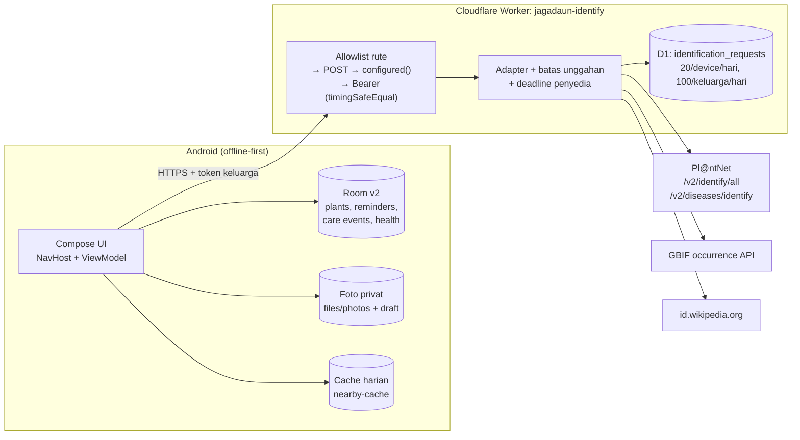

# Jaga Daun

Aplikasi Android berbahasa Indonesia untuk merawat tanaman: kenali tanaman dari foto, simpan koleksi pribadi, atur jadwal perawatan, periksa dugaan penyakit/hama, dan lihat tanaman apa yang tercatat di sekitar lokasi Anda.

Repositori ini berisi dua runtime yang saling melengkapi:

| Runtime | Isi | Teknologi |
| --- | --- | --- |
| `app/` | Aplikasi Android | Kotlin, Jetpack Compose, Material 3, Room, WorkManager, CameraX |
| `worker/` | Cloudflare Worker pemegang kredensial | TypeScript, Cloudflare Workers, D1 |

Aplikasi **tidak pernah** menyimpan API key penyedia. Semua panggilan ke Pl@ntNet lewat Worker; Android hanya mengenal satu URL keluarga dan satu token yang bisa dicabut dengan merotasi secret Worker.

## Fitur

| Fitur | Perilaku |
| --- | --- |
| **Kenali tanaman** | 1–5 foto (kamera terpandu atau galeri) dikirim ke Pl@ntNet lewat Worker. Hasil menampilkan nama Indonesia, nama ilmiah, dan dugaan kondisi dalam satu halaman. Hasil lemah meminta foto ulang, bukan menampilkan tebakan. |
| **Kebun Saya** | Koleksi privat di perangkat: foto, nama, catatan, pencarian lokal. Tambah manual tanpa jaringan. |
| **Pengingat perawatan** | Jadwal siram/kegiatan lain, jeda, tandai selesai. Room sumber kebenaran, WorkManager turunannya. Notifikasi lokal. |
| **Pemeriksaan terarah** | Pemeriksaan penyakit/hama 1–5 foto dengan panduan bersumber (UC IPM) untuk kode yang sudah dikurasi. |
| **Riwayat pemeriksaan** | Simpan dugaan, foto, catatan, dan status perkembangan menurut pengguna. Tetap terbaca offline. |
| **Tanaman di sekitar** | Spesies yang tercatat di GBIF dalam radius 5/10/25 km, lengkap dengan foto berlisensi CC + kredit, nama Indonesia dari Wikipedia, dan peta skematis interaktif. |
| **Panduan tanaman** | Bacaan lokal untuk Pepaya dan Mangga (varietas, ciri buah, tautan sumber). |

## Navigasi

Lima tujuan bawah meniru PictureThis: **Beranda · Periksa · kamera · Kebun · Lainnya**. Tombol kamera di tengah menonjol dengan warna hijau tua sendiri dan **langsung membuka kamera**; galeri ditawarkan di dalam layar kamera, bukan lewat dialog sumber foto. Tab lain tetap berupa label ikon dengan kapsul aktif. Riwayat, tanaman sekitar, dan panduan tetap tersedia sebagai halaman sekunder.

## Arsitektur



### Rute Worker

| Rute | Metode | Kuota | Kegunaan |
| --- | --- | --- | --- |
| `/health` | GET | tidak | Cek binding tanpa memanggil penyedia. |
| `/v1/identify` | POST | ya | Identifikasi satu JPEG. |
| `/v1/analyze` | POST | ya (1 reservasi, 2 kredit penyedia) | Identitas + kondisi dalam satu unggahan. |
| `/v1/health-check` | POST | ya (1 kredit) | Pemeriksaan penyakit/hama terarah. |
| `/v1/nearby` | POST | **tidak** | Spesies di sekitar via GBIF. |

Urutan pemeriksaan Worker adalah invarian keamanan dan tidak boleh diubah: allowlist rute → hanya POST → `configured()` → Bearer (SHA-256 + `timingSafeEqual`) → UUID perangkat → jenis konten `image/jpeg` (hanya rute bergambar) → batas unggahan/deadline → reservasi kuota → panggilan penyedia. `reserveQuota` selalu terakhir. Kegagalan penyedia tetap memakai kuota; tidak ada refund dan tidak ada retry otomatis.

### Batas teknis

| Batas | Nilai | Di mana |
| --- | --- | --- |
| Foto per permintaan | 5 | `MAX_ANALYSIS_PHOTOS`, `MAX_HEALTH_IMAGES` |
| Ukuran per JPEG | 4 MiB | `MAX_IMAGE_BYTES` (Worker) |
| Batas impor foto lokal | 30 MiB | `PhotoStore.MAX_IMPORT_BYTES` |
| Resolusi simpan/unggah | 2048 px, JPEG 90 | `PhotoStore` |
| Batas unggahan multipart | 5 × 4 MiB + 16 KiB | `readMultipartImages` |
| Deadline unggahan / penyedia | 15 s / 20 s | `UPLOAD_DEADLINE_MS`, `PROVIDER_DEADLINE_MS` |
| Respons Worker diterima klien | 64 KiB | `NearbyClient`, `IdentificationProtocol` |
| Radius sekitar | 1–50 km (UI 5/10/25) | Worker clamp + client `require` |
| Cache harian | 256 KiB, kunci `lat_lon_radius_tanggal` | `NearbyCache` |
| Kuota | 20/device/hari, 100/keluarga/hari, purge 7 hari | `RESERVE_QUOTA` |

### Invarian data

- **Kepemilikan foto ketat.** `NavHost` memiliki `draftPhotos`; layar tidak boleh membuang referensi yang bukan miliknya atau menghapus berkas yang tidak ia buat. Pembersihan foto tersimpan harus memeriksa referensi tanaman *dan* riwayat pemeriksaan.
- **Simpan atomik.** Repositori menyalin foto ke penyimpanan permanen sebelum transaksi Room; gagal transaksi menghapus salinan baru dan mempertahankan draf.
- **Pengingat idempoten.** Penyelesaian adalah compare-and-set pada waktu jatuh tempo yang diharapkan di dalam transaksi, jadi ketukan berulang tidak menggandakan catatan.
- **Cache tidak dipercaya.** Setiap pembacaan cache divalidasi ulang oleh parser respons yang sama; berkas rusak menjadi *miss* dan dihapus.
- **Lokasi hanya di memori.** Tidak ada riwayat lokasi. Perbaikan lokasi maksimal 10 menit, menunggu maksimal 20 detik, lalu gagal dengan pesan.

## Menjalankan aplikasi Android

Prasyarat:

- JDK 17
- Android SDK dengan platform 35 dan build-tools (set `ANDROID_HOME`, atau tulis `local.properties` — tidak di-commit)
- Perangkat atau emulator dengan Android 8.0+ (minSdk 26)

```bash
export ANDROID_HOME="$HOME/Android/Sdk"

./gradlew testDebugUnitTest lintDebug assembleDebug   # gate lengkap
./gradlew installDebug                                 # perangkat harus berstatus `device`
```

Toolchain terkunci di repositori: Gradle 8.9 (wrapper), AGP 8.7.3, Kotlin 2.0.21, KSP 2.0.21-1.0.28, compile/target SDK 35, `jvmToolchain(17)`. Daemon Gradle dimatikan, jadi gabungkan tugas dalam satu invokasi.

### Token keluarga saat build

`app/build.gradle.kts` membaca token pada waktu konfigurasi dari:

```
~/.config/jagadaun/family-token
```

Aturannya:

- Tidak ada berkas ⇒ token kosong ⇒ klien gagal tertutup (fitur jaringan menampilkan pesan, fitur lokal tetap jalan).
- Ada berkas ⇒ isinya harus cocok `[A-Za-z0-9_-]{32,128}`, kalau tidak build gagal.

Token ini masuk ke `BuildConfig.IDENTIFICATION_TOKEN`, sehingga **bisa diekstrak dari APK**. Distribusikan hanya ke keluarga; untuk mencabut akses, rotasi `FAMILY_TOKEN` di Worker dan build ulang.

### Menunjuk ke Worker lain

URL endpoint ada di `app/build.gradle.kts`:

```kotlin
buildConfigField("String", "IDENTIFICATION_URL", "\"https://<worker-anda>/v1/identify\"")
```

Klien menurunkan path saudara (`/v1/analyze`, `/v1/health-check`, `/v1/nearby`) dari host dan port URL itu. Skema wajib HTTPS, tanpa userinfo maupun query; cleartext traffic dimatikan di manifest.

## Menjalankan Worker

Prasyarat: Node.js ≥ 24 (eksekusi TypeScript native dan `node:sqlite` untuk tes), npm dengan lockfile yang di-commit.

```bash
cd worker
npm ci
npm test            # node --test test/*.test.ts
npm run typecheck   # tsc --noEmit
npm run build       # esbuild → dist/worker.js (entry deploy)
```

`dist/worker.js` di-gitignore, jadi **build sebelum deploy**. `wrangler` bukan dependensi repositori; deploy dijalankan di luar repo sesuai `worker/wrangler.jsonc`.

### Instance Worker sendiri

1. Buat Worker dan database D1.
2. Terapkan skema kuota: `wrangler d1 execute <db> --file=schema.sql`.
3. Set secret: `PLANTNET_API_KEY` dan `FAMILY_TOKEN`.
4. Sesuaikan `name`, `account_id`, dan `database_id` di `worker/wrangler.jsonc`.
5. `npm run build` lalu deploy `dist/worker.js`.

Observability sengaja dimatikan: URL upstream Pl@ntNet memuat API key, sehingga log permintaan tidak boleh direkam. Worker juga tidak pernah mencatat foto, nama tanaman, koordinat, atau isi galat penyedia — hanya kode galat yang sudah disanitasi.

### Data di D1

Hanya `request_id` acak, tanggal UTC, dan hash UUID perangkat (7 hari). Tidak ada foto, nama tanaman, catatan, atau identitas pengguna. UUID instalasi membagi kuota; itu bukan bukti identitas.

## Pengujian

| Suite | Perintah | Jumlah | Cakupan |
| --- | --- | --- | --- |
| JVM unit | `./gradlew testDebugUnitTest` | 56 tes | Parser protokol, ambang, pilihan kandidat, penjadwalan, transisi UI, cache nearby, label lisensi |
| Lint | `./gradlew lintDebug` | — | Wajib 0 error |
| Worker | `cd worker && npm test` | 54 tes | Route, auth, kuota pada SQLite in-memory nyata, batas unggahan, adapter dengan `fetch` tiruan |
| Perangkat | lihat di bawah | 30 tes | Room, migrasi `1 → 2`, promosi/rollback foto, cache gambar terkonfinasi, protokol, UI nearby |

Gate redesign `testDebugUnitTest lintDebug assembleDebug assembleDebugAndroidTest` lulus: **56 tes unit**, 0 error lint, APK aplikasi dan APK tes berhasil dibuat. Pengujian runtime dicatat terpisah di [ARCHITECURE.md](ARCHITECURE.md); build sukses tidak membuktikan kelancaran di perangkat.

### Tes perangkat tanpa menghapus data keluarga

`connectedDebugAndroidTest` dapat **melepas APK** setelah selesai, yang menghapus `databases/` dan `files/photos`. Pada perangkat berisi data penting, gunakan jalur manual:

```bash
./gradlew assembleDebug assembleDebugAndroidTest
adb install -r app/build/outputs/apk/debug/app-debug.apk
adb install -r app/build/outputs/apk/androidTest/debug/app-debug-androidTest.apk
adb shell am instrument -w com.jagadaun.app.test/androidx.test.runner.AndroidJUnitRunner

# satu kelas saja
adb shell am instrument -w -e class com.jagadaun.app.ui.nearby.NearbyScreenTest \
  com.jagadaun.app.test/androidx.test.runner.AndroidJUnitRunner
```

Tes UI nearby (`NearbyScreenTest`, 4 tes) sudah ditulis dan dikompilasi tetapi **belum pernah dijalankan** karena emulator terus dimatikan proses lain di host pengembangan. Perlakukan sebagai belum terbukti.

## Batas dan hal yang tidak diklaim

Bagian ini sengaja eksplisit agar tidak ada klaim berlebih:

- **Bukan diagnosis.** Hasil penyakit adalah keluaran model penyedia, bukan kepastian. Hasil kosong atau foto ditolak **tidak** berarti tanaman sehat.
- **Angka sekitar bukan kelimpahan.** Jumlah catatan GBIF mencakup pengamatan dan spesimen historis, bisa berulang dan tidak merata. Itu bukan kelimpahan, bukan kehadiran langsung, dan **bukan bukti spesies asli/endemik**. Fitur ini tidak menyimpulkan status tersebut.
- **Ambang nama.** Kandidat di bawah skor 0,30 tidak ditampilkan sebagai nama; UI meminta foto lebih dekat. Untuk banyak foto galeri biasa, jawaban yang benar adalah menolak memberi nama.
- **Akurasi terukur terbatas.** Benchmark 36 foto Wikimedia Commons (12 spesies) memberi top-1 68% untuk foto tunggal dan 82–90% untuk 1–3 sudut. Angka itu dari foto yang menonjolkan organ tanaman, bukan kebun nyata.
- **Biaya nyata.** Satu `/v1/analyze` memakai 2 kredit penyedia (identitas + kondisi), bukan 1.
- **Peta bukan peta jalan.** Peta digambar sendiri (Canvas) dari koordinat; tidak ada tile provider. Tombol "Buka di aplikasi peta" meneruskan koordinat ke aplikasi peta terpasang.
- **Belum ada CI.** Tidak ada workflow di `.github/`; semua gate dijalankan manual.

## Struktur repositori

```
app/
  src/main/java/com/jagadaun/app/
    AppContainer.kt          titik wiring tunggal (tanpa Hilt/Koin)
    AppNavHost.kt            semua rute, bottom bar, kepemilikan draft foto
    data/
      identification/        klien HTTPS + parser ketat (identify, analyze, health)
      nearby/                NearbyClient, NearbyCache
      local/                 Room: entitas, DAO, database, migrasi
      photos/PhotoStore.kt   karantina path, impor/promosi/hapus, sapuan draf 24 jam
      repository/            simpan atomik + rollback, pembersihan foto bersama
    domain/                  model & aturan murni Kotlin (tanpa import Android)
    reminders/               Room → WorkManager sync
    ui/                      layar per fitur (identify, garden, health, reminders,
                             camera, nearby, home, components, theme)
  src/test/                  56 tes JVM
  src/androidTest/           30 tes perangkat
  schemas/                   ekspor skema Room (v1, v2) — ikut di-commit
worker/
  src/worker.ts              seluruh Worker: rute, auth, kuota, adapter
  test/worker.test.ts        54 tes dengan fetch tiruan + SQLite in-memory
  schema.sql                 tabel & indeks kuota D1
```

## Dokumentasi lain

| Berkas | Isi |
| --- | --- |
| [`PRD (1).md`](PRD%20%281%29.md) | Cakupan produk, kriteria penerimaan JD-01…JD-06, privasi, rencana uji rilis |
| [`DESIGN.md`](DESIGN.md) | Palet, skala tipografi, tata letak layar, teks keadaan, aksesibilitas |
| [`ARCHITECURE.md`](ARCHITECURE.md) | Arsitektur rinci, operasi Worker, riwayat verifikasi, bukti inspeksi REA |
| [`AGENTS.md`](AGENTS.md) | Konvensi kode, perintah, dan aturan kerja untuk kontributor maupun agen |

> Catatan: nama berkas `ARCHITECURE.md` memang salah eja dan merupakan nama kanonik. Beberapa dokumen menautkan `PRD.md`, padahal nama sebenarnya `PRD (1).md`.

## Lisensi

Belum ada berkas lisensi di repositori ini, sehingga secara default berlaku hak cipta penuh pemiliknya. Tambahkan `LICENSE` sebelum menerbitkan atau menerima kontribusi eksternal.

Aset pihak ketiga membawa ketentuan masing-masing: foto tanaman di layar "Tanaman di sekitar" hanya ditampilkan bila berlisensi Creative Commons dengan kredit pemegang hak, data catatan dari [GBIF](https://www.gbif.org/), teks dan gambar dari Wikipedia bahasa Indonesia, identifikasi dari Pl@ntNet, serta panduan perawatan dari UC IPM.
